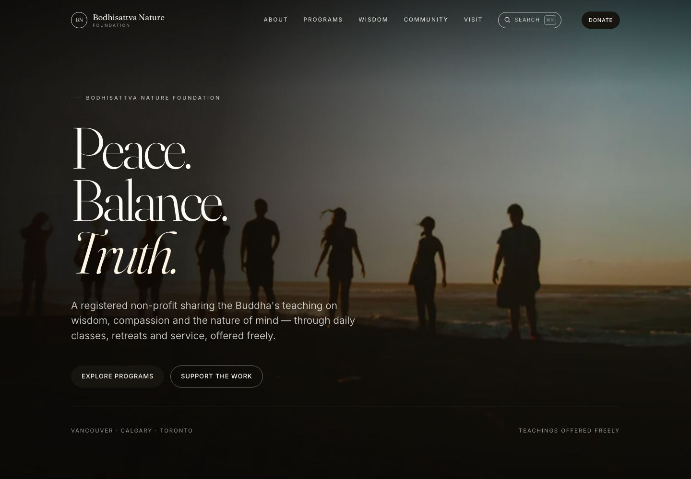
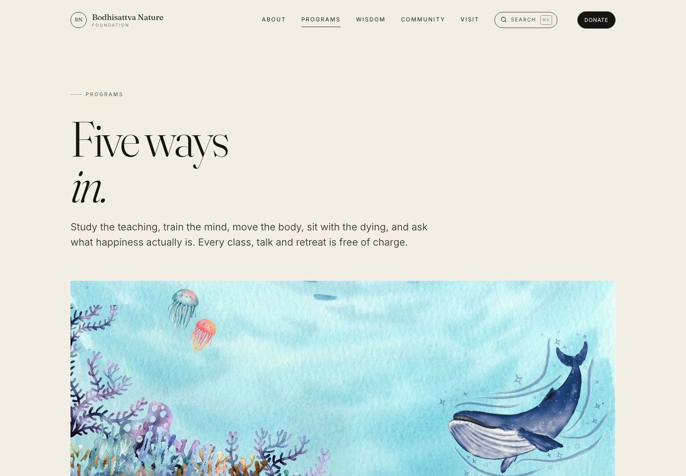
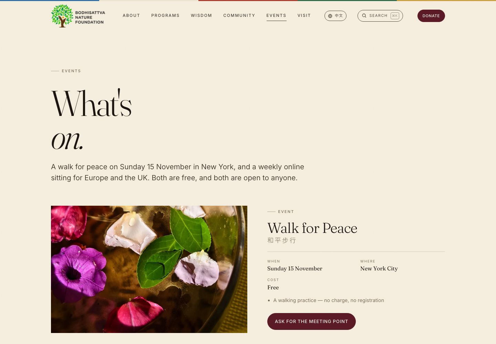

# Bodhisattva Nature Foundation, rebuilt

A static, GitHub Pages–ready rebuild of [bodhinature.com](https://bodhinature.com), built from the site's own
content rather than from its layout. Same foundation, same teachings, same contact details; new interface.

The original is WordPress 7.1.4 with the Divi builder, WooCommerce and GiveWP. Everything public on it was
harvested first (52 pages, 4 posts, 811 media items, 5 testimonials; see `DATA.md`), then the prose was
re-edited into a structured content model and a new front end was designed around it.



---

## Run it

```bash
cd site
npm install
npm run dev         # http://localhost:4321/bodhinature/
npm run build       # static output in site/dist
npm run preview     # localhost only
npm run preview:lan # bound to 0.0.0.0 — reachable from phones on the same Wi-Fi
```

`preview:lan` prints the LAN addresses. Astro's preview server reads `allowedHosts` from `server` (not
`preview`), so the Bonjour name works as well as the IP; that setting is in `astro.config.mjs`.

Node 22+ required. Astro 5 (pinned below 7 because this machine runs 22.23.2, and Astro 7 wants 22.23.4).

## Deploy to GitHub Pages

`.github/workflows/deploy.yml` builds and publishes on every push to `main`. Two environment variables drive
the paths:

| Variable | Purpose | Default |
| --- | --- | --- |
| `BASE_PATH` | Sub-path the site is served from | `/bodhinature/` |
| `SITE_URL` | Origin used for canonical URLs and the sitemap | `https://example.github.io` |

The workflow derives both from the repository, so a project page at `https://user.github.io/repo/` works with
no edits. For a user or organisation page (`https://user.github.io/`), set `BASE_PATH=/`.

In the repository: **Settings → Pages → Build and deployment → Source: GitHub Actions**.

To publish by hand instead:

```bash
cd site
BASE_PATH=/bodhinature/ SITE_URL=https://user.github.io npm run build
npx gh-pages -d dist
```

## Structure

```
site/
  src/
    data/site.ts        all page copy: programs, teachers, branches, schedule, testimonials
    data/quotes.json    14 short teachings, extracted from the original wisdom-words page
    data/images.json    generated image manifest (widths + variants)
    components/         Header, Footer, Img, Search
    layouts/Base.astro  head, metadata, reveal + drawer scripts
    pages/              one file per route; programs/[slug] generates the five programme pages
    styles/global.css   the whole design system
  public/
    media/              optimised WebP derivatives
    fonts/              Fraunces + Inter, latin subsets, self-hosted
```

15 routes in each language: home, about, programmes index, 5 programme pages, wisdom, community, events,
volunteer, donate, visit, 404 — English at the root, Chinese under `/zh/`. The original's 52 pages collapse into those 14. Most of the old pages were duplicate Divi layouts for the
same five programmes and five branch addresses.





## Two languages

The site is bilingual: English at `/` and Simplified Chinese at `/zh/`, with a globe button in the header that
swaps to the same page in the other language (hash preserved).

Content lives in two dictionaries — `src/i18n/en.ts` / `zh.ts` for interface copy, `src/data/*.ts` and
`src/i18n/zh-data.ts` for collections — covering 14 quotes, 5 programmes, 8 branches and 5 testimonials in both
languages. Every page is one view component under `src/views/` that takes a `lang`
prop; each route is a three-line wrapper. Pages set `<html lang>`, emit reciprocal `hreflang` links, and the
search palette has its own index per language.

Chinese is written rather than translated. The hero is 安乐 · 自在 · 真谛 rather than a literal Peace / Freedom /
Truth: 安乐 for peace-and-ease, 自在 the Mahayana word for freedom (观自在, 得大自在), 真谛 the ultimate truth. The three commitments
become 同体 (one body, as in 同体大悲) · 环境 · 觉悟, and the path is the canonical 闻 · 思 · 修. Terminology
follows 汉传 usage throughout — 四圣谛, 八正道, 临终关怀, 护持, 学员心得.

The toggle is 中文/English. Typography switches to a Songti/Source Han serif for headings with a PingFang body,
synthetic italics are disabled (CJK renders them badly) and accent words take the saffron colour instead.

## Design notes

The theme is built from the tradition rather than around it: parchment, monk-robe saffron, temple maroon,
gilded gold and jade. Fraunces for display, Inter for text, both self-hosted so the site makes no
third-party requests.

- **Parchment, not white.** The page sits on a warm sandalwood ground (#F6EFDF) with ink text at #1B1410,
  so the golden Buddha reads as an object in a room rather than an image on a screen. Five colours carry the
  whole palette: parchment #F6EFDF, saffron #BF6A1E, maroon #5B1A26, gold #D9AB54, jade #26443A.
- **Maroon bands.** Every dark section is the colour of a Tibetan robe (#3A0C16) with gold numerals
  (#D9AB54) and a 1px gilded rule along its top edge. The jade band is the one green interval, used for the numbers.
- **Ornament, used sparingly.** A five-colour prayer-flag strip runs along the top of the page; a lotus divides
  major sections and opens the footer; a low-opacity mandala is etched into the maroon bands and the corner of
  the hero. Those three are inline SVG, no ornament images. The header itself carries the foundation's own
  logo, and the favicon is their pixel-art version of the same bodhi tree, so tab and masthead match.
- **The Buddha sits in a niche.** The hero image is masked with a 46% / 20% elliptical arch, with a 1px gold
  outline offset 0.9rem behind it, so the banner reads as a shrine rather than a background photo. Below
  900px the hero stacks and the arch flattens to 4:5.
- **Motion is restrained.** Fade-and-rise on scroll, a slow brightness drift on the hero image, a marquee of
  programme and city names. All of it disabled under `prefers-reduced-motion`.
- **The foundation's own imagery, throughout.** 51 files drawn from `media/`. The hero is their golden-Buddha banner, the five programme
  cards are their illustrated icons (monk, flower figure, Tai Chi pair, hospice house, fish spiral), the
  branches use their map banners, About uses the bodhi-leaf emblem and the oneness photographs, the happiness
  page carries the four translated book covers, and donate carries the real PayPal mark and both QR codes.
  Nothing was substituted from stock; the only processing is WebP conversion into 124 derivatives and, for
  the emblem, keying its white background to transparent.
- **Search is local.** ⌘K opens a command palette over a JSON index built at compile time. No service, no
  key, no network.

## Accessibility and performance

- Semantic landmarks, skip-free linear heading order, `aria-current` on the active nav item.
- Every image carries alt text; decorative images are marked empty.
- Keyboard: ⌘K or the header button opens search, arrows move, Enter follows, Esc closes.
- Two variable fonts, latin and latin-ext subsets, 412 KB total, `font-display: swap`, preloaded.
- No client framework. The only JavaScript is the header, the drawer, the search palette and a quote
  rotator: about 3 KB of inline script per page, zero JS bundles.
- Breakpoints at 980px, 860px and 640px; the 390px layout stacks the hero and drops the arch to 4:5.
- Build metrics: 15 routes, 51 source images, 124 WebP derivatives, 5.9 MB of media, 7.9 MB in `dist`, and
  under 1 MB transferred for a full home page visit.
- `site/dist` is 6.3 MB, of which 5.5 MB is WebP across 112 files; a home page visit transfers 0.85 MB in 18
  requests. The archive behind it is 516 MB across 844 files.

## Content provenance

Every sentence on the site comes from the original pages. Programme copy, the Four Noble Truths, the
seven-point posture, the daily schedule, the volunteer roles, the donation methods, phone numbers and
addresses are all transcribed from bodhinature.com. Testimonials are the five published accounts, unedited
apart from trimming.

What was **not** carried over: the Divi layout, the Smart Slider carousels, the WooCommerce cart (the only
product is a donation), and the AIOSEO/GiveWP plumbing. Nothing was invented to fill a gap. Where the source
was vague, the copy is vague or the line is omitted.

## Re-harvesting

`scripts/` holds the Python used to build the archive: `harvest.py` (WP REST), `extract.py` (Divi HTML →
content blocks), `download_media.py`, `process_images.py`, plus `shot.mjs` for screenshots. They need the
`.venv` in the project root and are documented in `DATA.md`.
